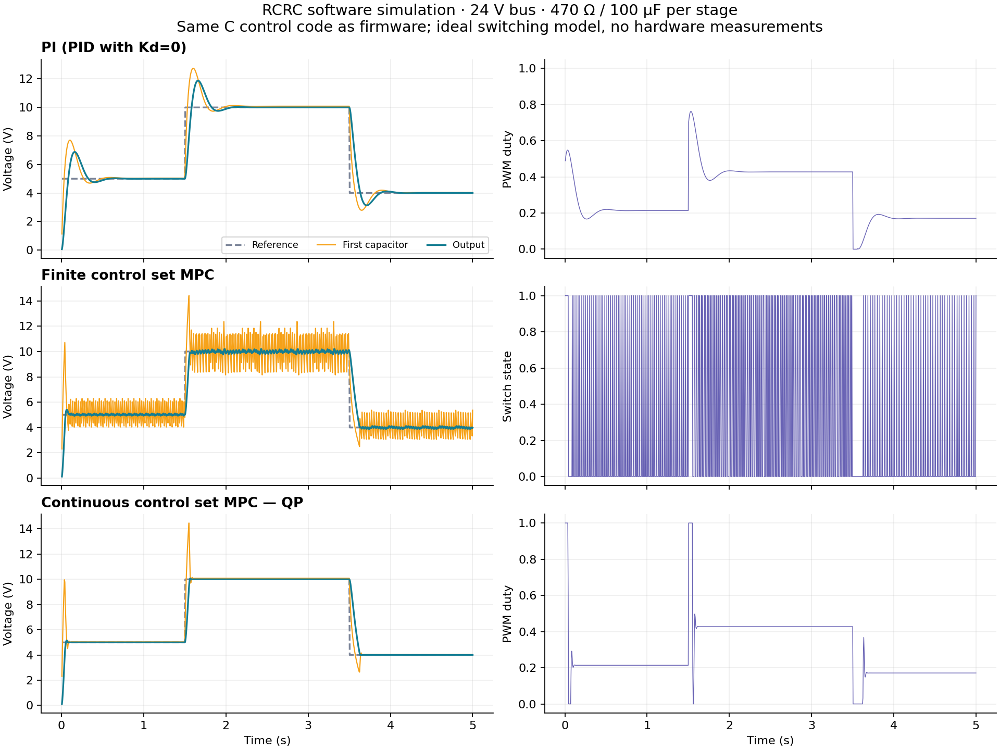

# STM32H723 RCRC control laboratory

C firmware for the supplied **STM32H723ZGT6 UC_PowerE-V2 / Conv_Edu** boards and a Python USB desktop application. Implements PI/PID, finite control set MPC, and continuous control set MPC with a constrained quadratic program. The controlled output is **ToC4**, the second capacitor of circuit 3; ToC3 is the first state. The other converter outputs are held low.

The included HEX is built for this pin mapping and a 16 MHz crystal. It starts with the bridge disabled. **Software compilation and simulation have been verified; physical USB enumeration, ADC accuracy, OLED operation, execution deadlines and power-stage behavior still need testing on your board.** See [validation](docs/validation.md) for the exact evidence and limits.

## Files and defaults

| Item | Location / value |
| --- | --- |
| Ready-to-program firmware | `release/rcrc_h723.hex` |
| Binary / debug symbols / linker map | `release/rcrc_h723.bin`, `.elf`, `.map` |
| Firmware entry and application | `firmware/src/main.c`, `app.c` |
| Portable controller implementation | `firmware/src/control.c` |
| H723 peripheral implementation | `firmware/platform/board_stm32h723.c` |
| Native USB CDC transport | `firmware/platform/usb_transport.c` |
| Python application | `desktop/app.py` |
| CPU / PWM / control sampling | 200 MHz / 20 kHz / 200 Hz (5 ms) |
| Default CS-MPC horizon | 8 samples (40 ms) |
| Allowed control sample period | 500–10,000 µs, integral microseconds |
| RCRC | R1=R2=470 Ω, C1=C2=100 µF; each sensor adds 55.7 kΩ to ground |
| Voltage limits / initial reference | Bus and capacitor maximum 30 V / reference 5 V |
| OLED | SSD1306, 128×64, I²C 0x3C |

The 30 V setting is a maximum, not a requested supply voltage. Use a lower, current-limited supply for initial commissioning. L298 output drops reduce the reachable output voltage; do not assume a 30 V output is reachable from a 30 V bus. Defaults use zero model drops until you measure and set `high_drop` and `low_drop`. PI integral action corrects moderate steady model error; MPC tracking depends on the configured model. Capacitor/resistor tolerances and any external load must also be reflected in the parameters.

## Program through BOOT0 and the internal bootloader

1. Disconnect converter bus power and let the capacitors discharge. Supply the MCU board appropriately and connect the **native USB_OTG** connector to the laptop, rather than the separate CH340 USB/UART connector.
2. Set/hold BOOT0 high, then reset the MCU to enter its ROM bootloader. STM32 option bytes must allow BOOT0 to select system memory; if entry fails, check ST AN2606 for STM32H72xxx and the actual boot option-byte settings. Firmware does not modify option bytes.
3. Open STM32CubeProgrammer, select **USB**, refresh the DFU device list, and connect. Windows may need the CubeProgrammer DFU driver; it is separate from the runtime serial driver.
4. Open `release/rcrc_h723.hex`, download it, and enable programming verification. The HEX contains flash addresses beginning at **0x08000000**; do not apply an offset. A raw `.bin` requires that start address explicitly.
5. Return BOOT0 low and reset. The ROM DFU device should be replaced by the application's USB CDC serial device. Launch the Python application below.

The firmware uses PA13 as enableB according to the schematic; no SWD debugger is required. Leave the converter bus disconnected throughout programming. The bridge stays disabled until an explicit ARM request and valid sensors/configuration are present.

## Run the laptop application

Install Python 3.10+ with Tk, then run from this project directory:

```sh
python -m venv .venv
# Linux/macOS: source .venv/bin/activate
# Windows: .venv\Scripts\activate
python -m pip install -r desktop/requirements.txt
python -m desktop.app
```

On Linux, Tk may require the distribution's `python3-tk` package and the user needs permission for the USB serial device (usually `/dev/ttyACM0`). The normal Windows Python installer includes Tk. USB CDC uses the OS serial driver; the line-rate setting does not determine the MCU sampling frequency.

Select the native USB serial port and Connect. Inspect the measured DC bus and capacitor voltages before ARM. Choose `mode=0` for PI/PID (`kd=0` gives PI), `mode=1` for FCS-MPC, or `mode=2` for CS-MPC. Stop before changing modes, sample period, system components, gains, model drops, ADC calibration or QP settings. The reference can change while running. All updates are checked by firmware. The GUI plots both capacitor voltages, reference, bus voltage and duty; it also shows fault and QP diagnostics and exports recorded samples to CSV.

Closing/disconnecting requests STOP. Firmware independently stops on a communication timeout, USB session loss, voltage fault, stale/invalid ADC samples, control deadline miss, or failed QP. CLEAR only clears a removed fault and never starts the bridge. These software interlocks do not replace a current-limited supply or independent protection.

Parameters are in RAM and reset to defaults after a power cycle. Save parameters records their values on the laptop; it does not write MCU flash. More details: [desktop guide](desktop/README.md), [protocol and fault bits](docs/protocol.md).

## OLED and four-button menu

The display shows the controller, RUN/STOP state, fault, output/reference voltages, first capacitor/bus voltages, duty and sampling period. UP/DOWN scroll through every control/system/calibration parameter; LEFT/RIGHT decrease/increase the selected value. Edits use the same validation as the USB interface, including STOP requirements. Press **LEFT+RIGHT together to STOP**. ARM is issued from the laptop; the menu does not bypass the USB heartbeat requirement. OLED is optional: a missing display does not prevent USB operation.

## Build using STM32CubeIDE or Arm GNU tools

All required ST HAL, CMSIS device/startup and USB CDC source dependencies are included under `vendor/`, with their licenses, pinned revisions and checksums. STM32CubeMX generation or a separately installed Cube firmware package is unnecessary. This is an **external Make project**, not a CubeMX-generated `.ioc` project.

In STM32CubeIDE, use **File → Import → General → Existing Projects into Workspace**, select this directory and import `RCRC_H723`. The provided `.project` / `.cproject` call the included Makefile. Ensure `make` and `arm-none-eabi-gcc` are on the project's build PATH; CubeIDE's bundled compiler can be used by adding its `tools/bin` directory in **C/C++ Build → Environment**, or set the Make variable `CROSS_COMPILE` to its full `arm-none-eabi-` prefix. On Windows use forward slashes in the prefix and a Make-compatible shell/utilities. Build target `all`; programming uses CubeProgrammer USB DFU as above. Generated files appear in `build/`. The IDE's graphical import itself has not been tested in this environment.

Command-line equivalent:

```sh
make -j4                    # Arm GNU toolchain already on PATH
python tools/check_hex.py build/rcrc_h723.hex
```

A checksum-pinned Linux x86_64 compiler installer is provided:

```sh
bash tools/bootstrap-toolchain.sh
make -j4 CROSS_COMPILE="$PWD/.tools/xpack-arm-none-eabi-gcc-14.2.1-1.1/bin/arm-none-eabi-"
```

The verified build used GNU Arm GCC 14.2.1, Cortex-M7 hard-float, `-O2`, nano newlib and float printf. Flash is 1 MiB, AXI SRAM 320 KiB (including DMA buffers), and DTCM 128 KiB for the stack. D-cache is kept disabled for ADC DMA coherency; I-cache is enabled. Changing memory layout/cache behavior requires reviewing DMA access and coherence.

## Reproduce software verification and simulation

```sh
make host                  # C tests and desktop simulation library, native GCC
python -m pip install -r tests/requirements.txt
python -m pytest -q -s
python tools/plot_simulation.py
python -m desktop.app --demo
```

`--demo` uses the same compiled C controllers and an exact discrete RCRC model with a simulated 24 V bus. Windows/macOS can build an equivalent native library and pass `--library`; the included Linux `.so` is for Linux x86_64 only. Demo results are not hardware measurements. The [controller derivation](docs/controllers.md) explains discretization, horizon/weights, QP constraints, finite switch decisions and limitations. The [hardware review](docs/hardware-review.md) records schematic evidence and wiring.


